# RoTaKip – Okuma Takip Sistemi

Okuma alışkanlığınızı takip etmek, kullanıcı istatistiklerini görmek ve grup motivasyonunu artırmak için geliştirilmiş modern bir uygulaması.

🌐 [https://rotakip.up.railway.app/](https://rotakip.up.railway.app/)

[](https://rotakip.up.railway.app/)
[](https://nodejs.org/)
[](https://expressjs.com/)
[](#-api-mimarisi-rest-api)
[](https://www.mongodb.com/)
[](https://developer.mozilla.org/en-US/docs/Web/JavaScript)
[](https://developer.mozilla.org/en-US/docs/Web/HTML)
[](https://developer.mozilla.org/en-US/docs/Web/CSS)

---

## Temel Özellikler

### Grup & Kullanıcı

- Okuma grupları oluşturma ve katılım
- Herkese açık / özel grup görünürlüğü, arama ve filtreleme  
- Admin / üye rol sistemi  
- Profil ve grup avatarları (**Dropbox**)  

### Okuma Takibi

- Haftalık tabloda günlük okuma işaretleme (okudum / okumadım / boş)  
- Lig sistemi (Bronz → Gümüş → Altın)
- Okuma serisi takibi  
- Haftalık ve aylık istatistikler, takvim görünümü  
- Otomatik okuma işaretleme entegrasyonları (**WhatsApp**)

### Motivasyon

- Günün sözü, ayet & hadis, dua paylaşımları  
- YouTube video entegrasyonu  
- Lig atlama ve diğer bildirimler (**OneSignal**)  

### Güvenlik & Yönetim

- Şifreli giriş, rol tabanlı yetkilendirme  
- Giriş ve erişim logları  
- Zamanlanmış otomatik yedekleme  
- Admin paneli, katılma isteklerini yönetme  
- Site trafiği ve kullanım analizi (**Google Analytics**)  

---

## 📸 Ekran Görüntüleri

| Ana Sayfa | Haftalık Tablo | Günlük Görevler |
|:---------:|:--------------:|:---------------:|
| 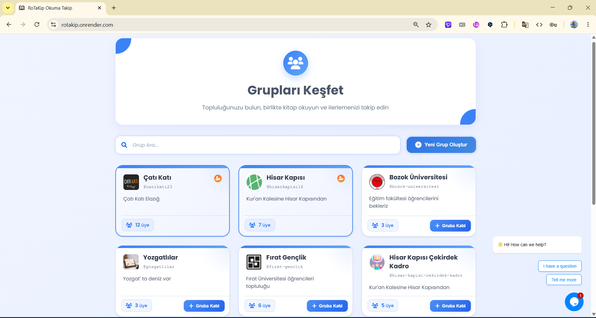 | 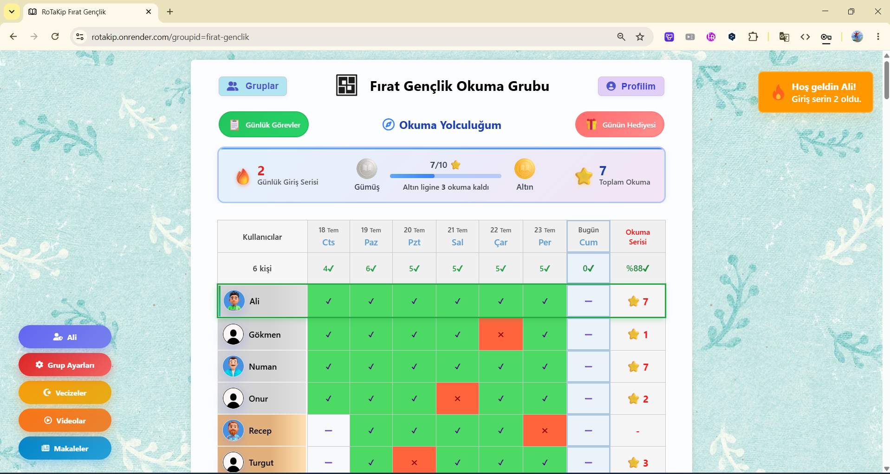 | 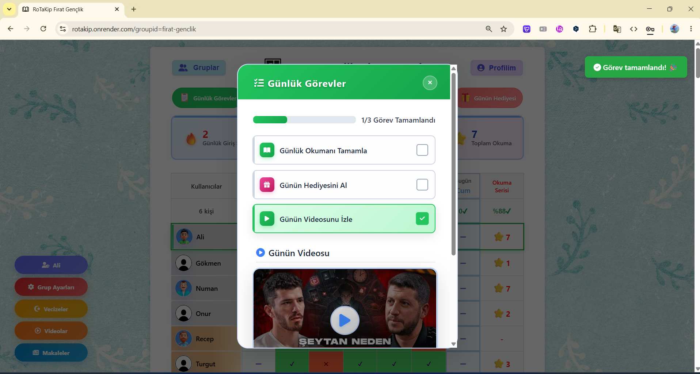 |

| Günün Hediyesi | Profil Ekranı | Kutlama Mesajları |
|:--------------:|:-------------:|:-----------------:|
| 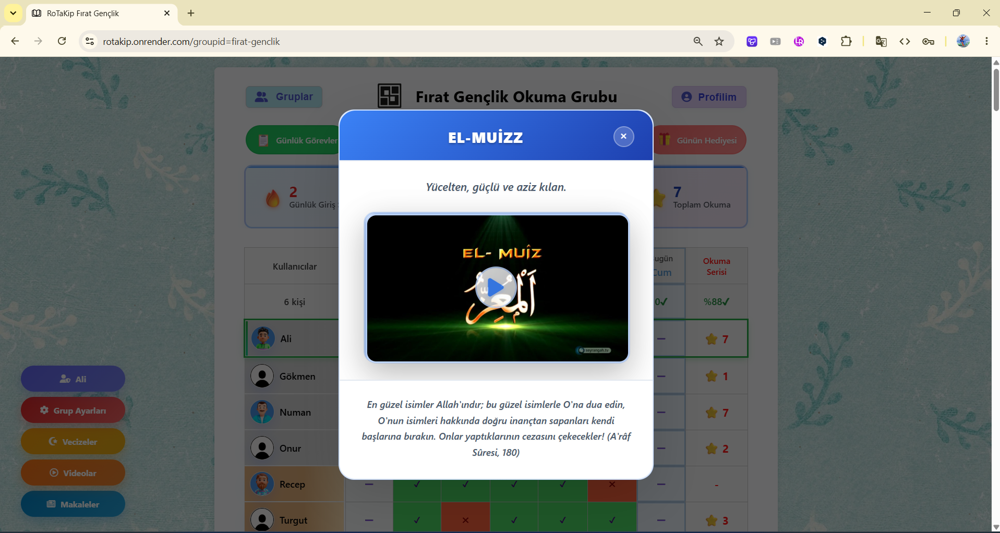 | 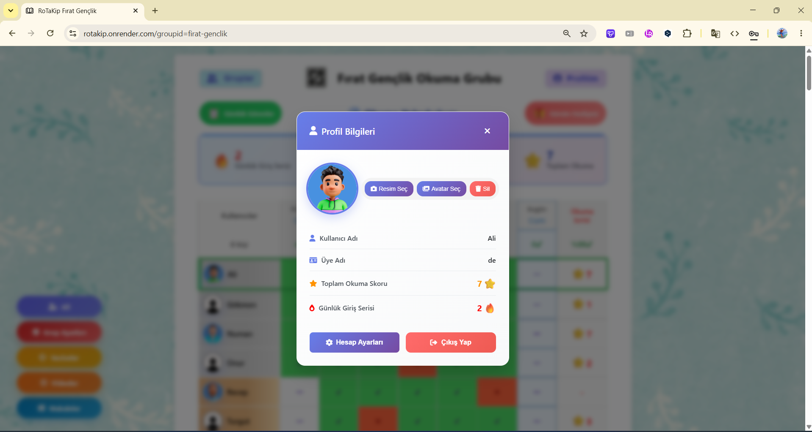 | 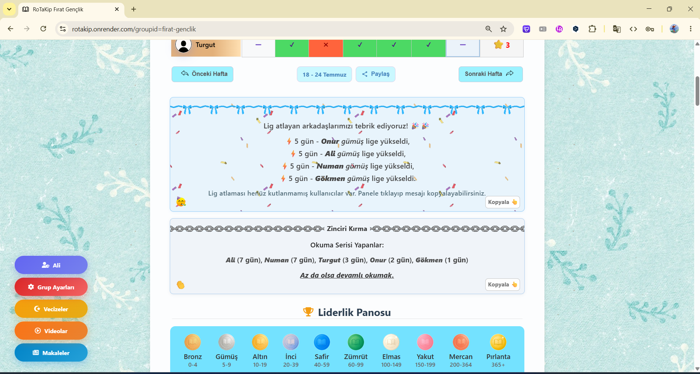 |

| Liderlik Panosu | Aylık Takvim | En Uzun Seri Grafiği |
|:----------------:|:------------:|:--------------------:|
| 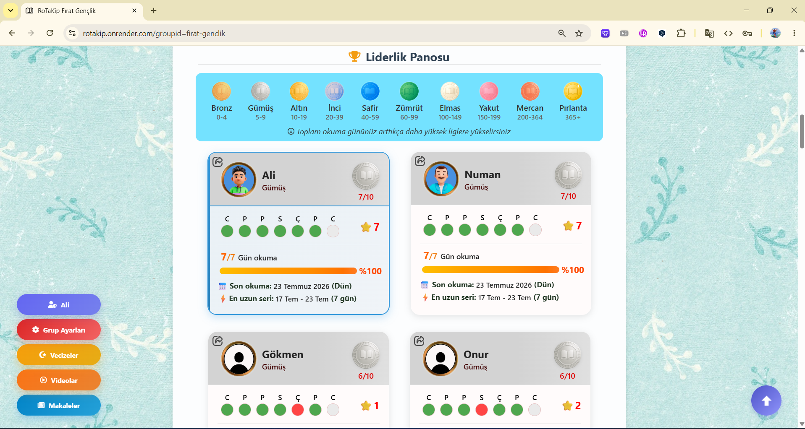 | 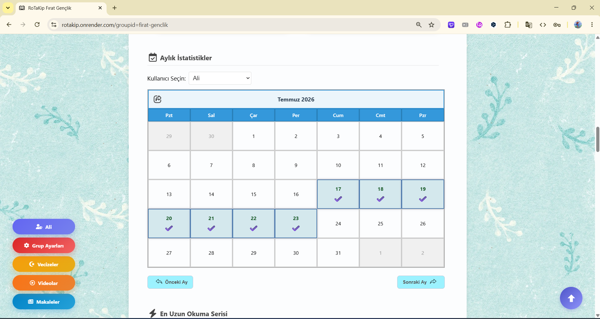 | 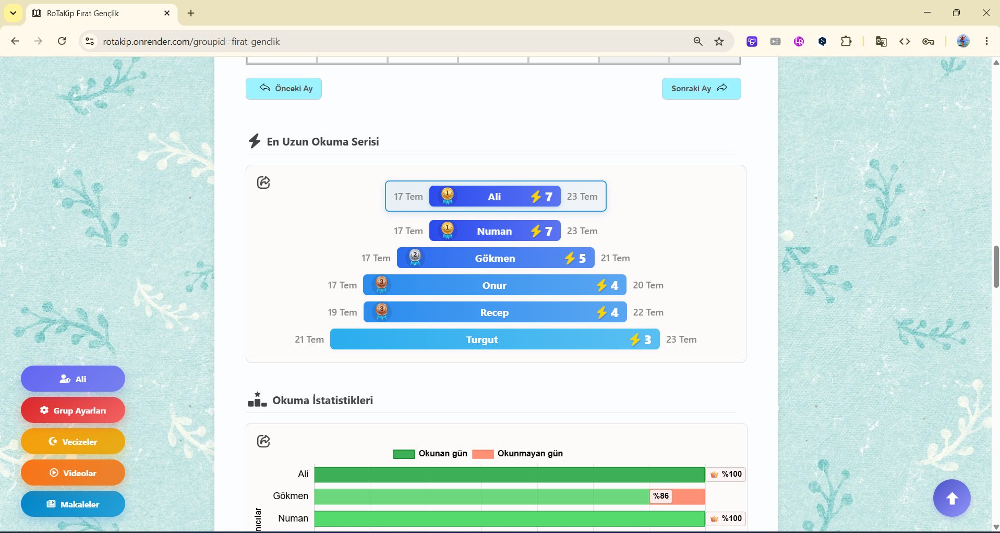 |

| Okuma Grafiği | Tefekkür | Videolar |
|:-------------:|:----------------:|:--------:|
| 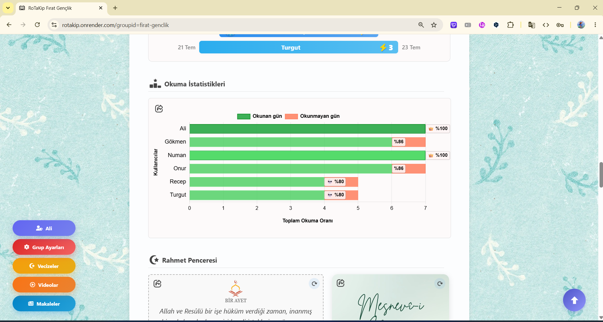 | 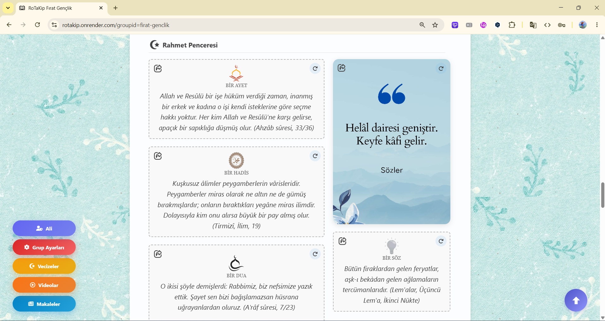 | 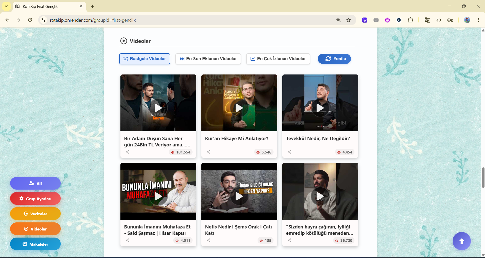 |

| Makaleler | Grup Ayarları | Tercihler |
|:---------:|:-------------:|:---------:|
| 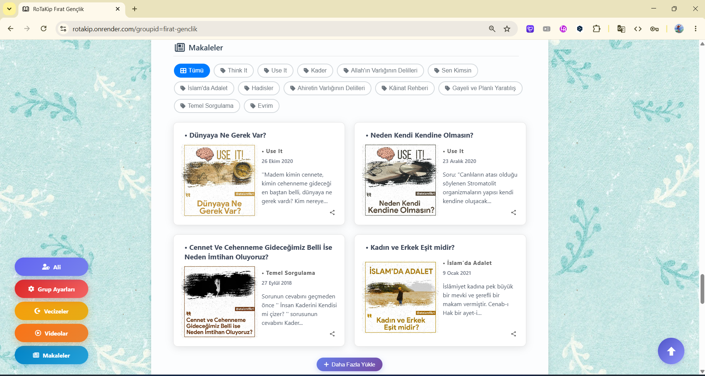 | 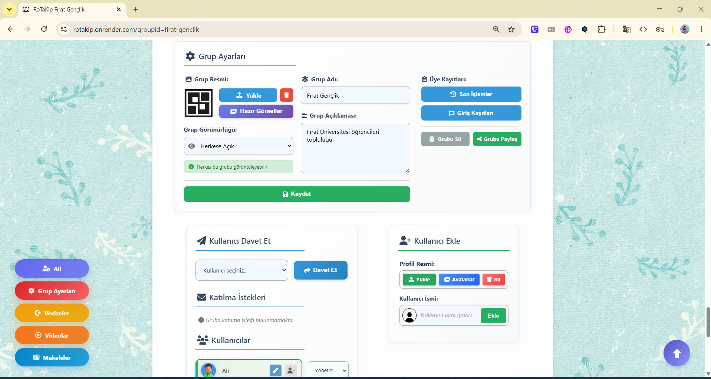 | 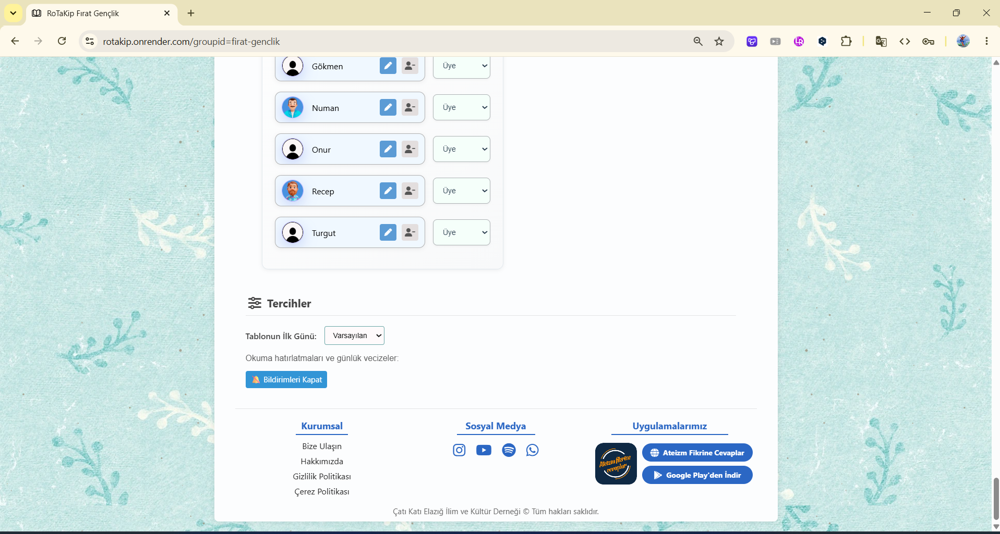 |

---

## API Mimarisi (REST API)

İstemci ve sunucu arasındaki veri iletişimi **REST API** standartlarına uygun uç noktalar (endpoints) üzerinden gerçekleştirilir:

- **Grup & Üye İşlemleri:** `GET /api/groups`, `GET /api/users/:groupId`, `POST /api/add-user/:groupId`, `DELETE /api/delete-group/:groupId` ...
- **Okuma & Durum Güncelleme:** `POST /api/update-status/:groupId`, `GET /api/user-stats/:groupId/:userId`, `GET /api/reading-stats/:groupId` ...
- **Yönetim & Loglar:** `POST /api/admin-login`, `GET /api/access-logs`, `GET /api/login-logs` ...

---

## Teknolojiler

**Backend:** Node.js, Express, MongoDB / Mongoose, Multer, Sharp, node-schedule, Moment.js  

**Frontend:** Vanilla JavaScript, CSS3, Font Awesome  

**Entegrasyonlar:** Whatsapp, Dropbox, OneSignal, YouTube, Google Analytics

---

## Sekmeli Uygulama Mimarisi

Kaynak yerleşimi, dosya sahipliği ve geliştirme kuralları için [mimari belgesine](docs/architecture.md) bakın.

Grup deneyimi ortak `app-shell.html` kabuğu üzerinde, route'a göre tembel yüklenen fragment ve asset paketlerinden oluşur. Okuma gruplarını keşfetme ekranının görünümü `public/fragments/gruplar.html` dosyasıdır ve `/gruplar` rotasında shell içine yüklenir:

- `/grup/:groupId/` — haftalık takip, motivasyon panelleri, grup ayarları, lig kartları, aylık takvim ve grafikler
- `/tesbihat` — bağımsız Tesbihat sekmesi; `/` bu adrese yönlendirilir (içerik daha sonra eklenecek)
- `/videolar`, `/tefekkur`, `/makaleler` — grup bağlamından bağımsız içerikler

İstemci kaynakları `src/client/`, shell yönlendirmesi `public/app/`, görünüm HTML'leri `public/fragments/` altındadır. `npm run build` sekmeye özel CSS/JS paketlerini üretir ve içerik hash'lerini `public/assets-manifest.json` içine yazar. Üretilmiş paketler Git tarafından takip edilmez. `/groupid=:groupId` bağlantıları query parametrelerini koruyarak kanonik grup adresine yönlendirilir.

`admin.html`, `access-logs.html` ve `login-logs.html` bağımsız yönetim belgeleridir. Kaynakları `src/client/features/site-activity-admin/` ve `src/client/features/activity-logs/` altında paketlenir; uygulama shell'inin sekme ön yükleme akışına dahil edilmez ve yalnız doğrudan açıldıklarında yüklenir.

---

## Kurulum

```bash
git clone [repo-url]
cd reading-tracker
npm install
npm start
```

Uygulama varsayılan olarak **http://localhost:3000** adresinde açılır (`PORT` ile değiştirilebilir).

---

## Ortam Değişkenleri (`.env`)

Kök dizinde `.env` oluşturup değerleri doldurun:

```env
# MongoDB
MONGO_URI=mongodb://localhost:27017/reading-tracker
DB_NAME=readingTracker
SESSION_SECRET=uzun-rastgele-bir-deger

# Dropbox — yükleme için erişim jetonu; yenileme için uygulama anahtarları
DROPBOX_APP_KEY=
DROPBOX_APP_SECRET=
DROPBOX_REFRESH_TOKEN=

# OneSignal (REST API anahtarı ONESIGNAL_API_KEY ile)
ONESIGNAL_APP_ID=
ONESIGNAL_API_KEY=
```

Dropbox ve OneSignal olmadan temel sayfalar çalışabilir; dosya yükleme ve push bildirimleri bu anahtarlara bağlıdır.

---

## Geliştirici

**Ali Kaçar**

[](https://www.instagram.com/alikacar23/)
[](https://www.linkedin.com/in/alikacar23/)
[](https://github.com/AliKacarr)
[](https://www.youtube.com/@alikacardev)

[alikacardev@gmail.com](mailto:alikacardev@gmail.com)

---

## Lisans

Bu proje [MIT Lisansı](LICENSE.txt) ile lisanslanmıştır.
